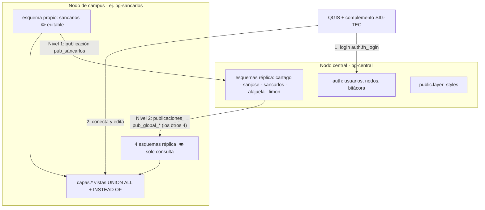

# SIG-TEC — Arquitectura distribuida y modelo geográfico

*Módulo: Samuel — Diseño de arquitectura (15 %) e implementación de nodos y estructura PostGIS (15 %)*

## 1. Visión general

SIG-TEC es un sistema distribuido con **6 instancias PostgreSQL 16 + PostGIS 3.4**:

| Nodo | Contenedor | campus_id | Puerto host | Función |
|---|---|---|---|---|
| Central | `pg-central` | — | 5440 | Autenticación, coordinación, copia consolidada, estilos |
| Cartago | `pg-cartago` | 1 | 5441 | Nodo operativo |
| San José | `pg-sanjose` | 2 | 5442 | Nodo operativo |
| San Carlos | `pg-sancarlos` | 3 | 5443 | Nodo operativo |
| Alajuela | `pg-alajuela` | 4 | 5444 | Nodo operativo |
| Limón | `pg-limon` | 5 | 5445 | Nodo operativo |

Principio rector: **cada dato tiene un único dueño** (el campus donde se creó). Solo el nodo dueño escribe; todos los demás tienen copias de consulta. Así se evita el multimaestro, que PostgreSQL no ofrece de forma nativa.



## 2. Distribución de los datos (dos niveles)

**Todos los nodos tienen la misma estructura**: los esquemas `cartago`, `sanjose`, `sancarlos`, `alajuela` y `limon`, cada uno con las mismas 8 tablas. Lo único que cambia es quién es dueño:

| Nodo | Esquema propio (escritura) | Esquemas réplica (solo lectura) |
|---|---|---|
| Central | ninguno | los 5 |
| Campus X | `X` | los otros 4 |

- **Nivel 1 (campus → central):** cada campus publica su esquema propio; el central se suscribe y guarda una copia física en el esquema homónimo.
- **Nivel 2 (central → campus):** el central re-publica cada esquema; cada campus se suscribe a los **otros cuatro** (nunca al propio, así no hay ciclos).

Como el esquema y la tabla son idénticos en origen y destino, la replicación lógica funciona sin mapeos.

## 3. Sistema de referencia espacial

- **SRID institucional: 5367 — CR05 / CRTM05**, proyección oficial de Costa Rica, en metros (áreas y longitudes directas).
- Todas las columnas son `geometry(<Tipo>, 5367)`.
- `sig.fn_a_srid_institucional(geom)` normaliza la entrada: SRID 0 → se asume 5367; otro SRID (ej. 4326 de un GPS) → `ST_Transform` a 5367. Los disparadores INSTEAD OF la usan antes de escribir.

## 4. Modelo geográfico

### 4.1 Columnas comunes (las 8 capas)

| Columna | Tipo | Regla |
|---|---|---|
| `id` | bigint PK | **ID global**: secuencia propia del campus con rango reservado (ver 4.3) |
| `campus_id` | smallint | `CHECK (campus_id = <campus del esquema>)`, FK a `sig.campus` |
| `creado_en`, `actualizado_en` | timestamptz | los mantiene el disparador `tg_auditoria` |
| `actualizado_por` | text | `session_user` del último cambio |
| `geom` | geometry(…, 5367) | NOT NULL, índice GiST; polígonos con `CHECK (ST_IsValid(geom))` |

### 4.2 Capas

| Capa (tabla/vista) | Geometría | Atributos | Valores permitidos |
|---|---|---|---|
| `edificios` | Polygon | codigo (único por campus), nombre, pisos, uso, **area_m2** (calculada) | uso: academico, administrativo, laboratorio, biblioteca, deportivo, residencia, servicios, otro |
| `carreteras` | LineString | nombre, tipo, superficie, **longitud_m** | tipo: principal, secundaria, interna, servicio · superficie: asfalto, concreto, adoquin, lastre, tierra |
| `aceras` | LineString | material, ancho_m, condicion, **longitud_m** | material: concreto, adoquin, asfalto, lastre, otro · condicion: buena, regular, mala |
| `parqueos` | Polygon | nombre, tipo, capacidad, espacios_disponibles (≤ capacidad), **area_m2** | tipo: estudiantes, funcionarios, visitantes, discapacidad, motos, bicicletas, mixto |
| `zonas_verdes` | Polygon | nombre, tipo_vegetacion, **area_m2** | cesped, arbustos, bosque, jardin, mixta |
| `puntos_interes` | Point | nombre, tipo, descripcion, horario | cajero, laboratorio, soda, biblioteca, auditorio, oficina, servicio_sanitario, parada_bus, otro |
| `iluminacion` | Point | codigo (único por campus), potencia_w, tipo_lampara, estado | lámpara: led, sodio, halogenuro, fluorescente, solar, otro · estado: funcionando, danada, mantenimiento |
| `accesibilidad` | LineString | tipo, descripcion, cumple_ley_7600, estado | tipo: rampa, paso_accesible, ruta_podotactil, pasamanos, otro |

`area_m2` y `longitud_m` son columnas generadas (`ST_Area` / `ST_Length` en CRTM05). No se replican: cada nodo las recalcula al recibir la fila.

### 4.3 Identificador global

Cada campus tiene `<esquema>.seq_id_global`, compartida por sus 8 capas, con un rango exclusivo:

| Campus | Rango de `id` |
|---|---|
| Cartago (1) | 1 000 000 001 – 1 999 999 999 |
| San José (2) | 2 000 000 001 – 2 999 999 999 |
| San Carlos (3) | 3 000 000 001 – 3 999 999 999 |
| Alajuela (4) | 4 000 000 001 – 4 999 999 999 |
| Limón (5) | 5 000 000 001 – 5 999 999 999 |

Garantiza unicidad sin coordinación entre nodos, y el primer dígito del `id` ya indica el campus. Además, cada tabla tiene un `CHECK` del rango, así que es imposible guardar en `sancarlos.edificios` un registro de otro campus.

### 4.4 Catálogos (esquema `sig`, igual en todos los nodos)

- `sig.campus` — 5 campus: `codigo` (= nombre de esquema), nombre, punto de referencia `centro`.
- `sig.capa` — las 8 capas, tipo de geometría y **orden de dibujo** (lo usa el plugin).
- `sig.nodo_local` — identidad del nodo (fila única). `sig.fn_campus_local()` devuelve el campus del nodo (NULL en el central). Es una tabla y no un `SET` para que un usuario no pueda cambiarse de campus en su sesión.

## 5. Seguridad y roles

| Rol | Dónde | Para qué |
|---|---|---|
| `replicador` | todos | LOGIN + REPLICATION; suscripciones lógicas y `pg_basebackup`; SELECT sobre todos los esquemas de campus |
| `sigtec_lectura` | todos | grupo: SELECT sobre catálogos y capas |
| `sigtec_editor` | todos | grupo: hereda lectura; USAGE de la secuencia local. Edita **solo vía vistas** `capas.*` |
| `sigtec_login` | central | único permiso: `EXECUTE auth.fn_login` (+ leer `sig.capa`/`sig.campus`) |
| `editor_<campus>`, `consulta_<campus>` | central (auth) + nodo de su campus | usuarios demo, clave `SIGTEC_DEMO_PASSWORD` |

Las contraseñas de `auth.usuario` se guardan con bcrypt (`pgcrypto`). Los usuarios existen en el central (para autenticar) y como rol en el nodo de su campus (para conectarse). `scripts/crear_usuario.sh` crea ambos.

## 6. Autenticación central

```sql
-- conectado al central como sigtec_login
SELECT * FROM auth.fn_login('editor_sancarlos', 'Tec2026!');
```
Devuelve 1 fila (acceso concedido) con: `usuario_id, username, nombre_completo, rol, campus_id, campus_codigo, campus_nombre, host, puerto, base_datos, esquema_vistas`. 0 filas = rechazado. Cada intento queda en `auth.bitacora_acceso`. Los datos de conexión de cada nodo están en `auth.nodo` (host para QGIS y host interno de la red docker).

## 7. Parámetros de servidor (comunes)

| Parámetro | Valor | Usado por |
|---|---|---|
| `wal_level` | logical | replicación lógica |
| `max_wal_senders` / `max_replication_slots` | 20 / 20 | suscripciones + basebackup |
| `max_logical_replication_workers` / `max_worker_processes` | 12 / 24 | aplicadores de suscripciones |
| `max_prepared_transactions` | 20 | transacciones distribuidas 2PC |
| `archive_mode` / `archive_command` | on / copia a `/wal_archive` | PITR |
| `timezone` | America/Costa_Rica | auditoría |
| `hba_file` | `config/pg_hba.conf` | permite `replication` por red |

Volúmenes por nodo: datos en volumen docker; `./wal_archive/<nodo>` y `./backups/<nodo>` en el host.

---

## 8. Contratos para los otros módulos

### Gabo — replicación y vistas
- Nombres sugeridos:
  - En cada campus X: `CREATE PUBLICATION pub_X FOR TABLES IN SCHEMA X;`
  - En el central: `CREATE SUBSCRIPTION sub_central_X CONNECTION 'host=pg-X dbname=sigtec user=replicador password=…' PUBLICATION pub_X;`
  - En el central: `CREATE PUBLICATION pub_global_X FOR TABLES IN SCHEMA X;` (×5)
  - En cada campus X: **una** suscripción `sub_X_global` al central con las 4 `pub_global_*` que no son X.
- **Las publicaciones y suscripciones se crean conectado como `postgres`** (`docker exec pg-X psql -U postgres -d sigtec`), en ambos lados:
  - `CREATE PUBLICATION … FOR TABLES IN SCHEMA` exige superusuario en PG16.
  - El dueño de la suscripción es quien aplica los cambios en las tablas réplica, y `replicador` solo tiene SELECT.
  - `replicador` va **únicamente dentro de la cadena `CONNECTION`**: es el usuario con el que el suscriptor se conecta al nodo que publica y hace la copia inicial (`copy_data`). En ese lado necesita SELECT, y ya lo tiene.
- Vistas: `capas.<capa_codigo>` = `UNION ALL` de los 5 esquemas, mismas columnas. QGIS usará `id` como clave (es global y única).
- INSTEAD OF: si `campus_id` viene NULL usar `sig.fn_campus_local()`; si no coincide con `sig.fn_campus_local()` → `RAISE EXCEPTION`. Normalizar con `sig.fn_a_srid_institucional()`. Escribir en `sig.fn_esquema_local()`. En UPDATE/DELETE validar el `campus_id` de OLD. Función `SECURITY DEFINER`.
- Permisos de vistas: SELECT a `sigtec_lectura`; INSERT/UPDATE/DELETE a `sigtec_editor`.
- En el central: nada de vistas editables (no tiene esquema propio).

### Andrés — complemento PyQGIS
- Login: conectar a `localhost:5440/sigtec` como `sigtec_login`, llamar `auth.fn_login`.
- Con la fila devuelta, conectar a `host:puerto/base_datos` con el usuario y clave escritos por el usuario.
- Capas a cargar: `SELECT capa_codigo, nombre FROM sig.capa ORDER BY orden` → vista `capas.<capa_codigo>`, clave `id`, geometría `geom`, SRID 5367.
- Estilos: `public.layer_styles` en el central (QGIS la crea al guardar un estilo en la BD). Coordinar con Gabo su publicación hacia los campus.
- Formularios: usar la tabla de valores permitidos del punto 4.2 para *Value Map*; `area_m2`, `longitud_m`, `creado_en`, `actualizado_*` deben ir como solo lectura.

### Justin — respaldos y transacciones
- Archivado WAL ya activo: `./wal_archive/<nodo>`. Carpeta de respaldos: `./backups/<nodo>` (montada en `/backups`).
- `pg_basebackup -h pg-X -U replicador -D /backups/base_… -X stream` funciona (pg_hba permite `replication`).
- 2PC listo (`max_prepared_transactions=20`). Caso natural: `scripts/crear_usuario.sh` toca dos nodos (central y campus) → volverlo atómico con `PREPARE TRANSACTION` / `COMMIT PREPARED`.
- Ojo en la prueba de recuperación: al restaurar un nodo con PITR, los slots de replicación de ese nodo vuelven al estado del respaldo; documentar cómo se resincroniza (re-crear la suscripción con `copy_data = true` desde el central).
