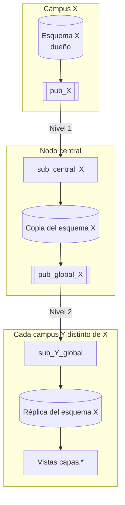

# SIG-TEC — Replicación lógica y vistas distribuidas

*Módulo: Gabo — Replicación lógica y vistas distribuidas (20 %)*

## 1. Objetivo y alcance

Este módulo logra que cada uno de los seis nodos disponga de la información geográfica de los cinco campus, manteniendo una regla central de la arquitectura: **cada dato tiene un único nodo dueño**. Para ello se implementan:

1. Replicación lógica en dos niveles, de los campus al central y del central a los campus.
2. Ocho vistas integradas `capas.*`, que son el punto de consulta y edición para QGIS.
3. Disparadores `INSTEAD OF`, que restringen la escritura al campus local.
4. Un script de operación y una batería de pruebas automáticas.

## 2. Diseño de la replicación



| Nivel | Sentido | Publicación | Suscripción | Cantidad |
|---|---|---|---|---|
| 1 | campus → central | `pub_<campus>` en cada campus | `sub_central_<campus>` en el central | 5 y 5 |
| 2 | central → campus | `pub_global_<campus>` en el central | `sub_<campus>_global` en cada campus, con las 4 publicaciones ajenas | 5 y 5 |

Cada suscripción crea en su publicador un *slot* lógico con su mismo nombre. El central aloja los cinco slots `sub_<campus>_global`, y cada campus aloja su slot `sub_central_<campus>`.

El Nivel 1 se monta por completo antes que el Nivel 2, de modo que la copia inicial hacia los campus ya contenga los datos de todos. Las suscripciones se crean una por una para limitar la carga de la copia inicial sobre el central y para identificar con claridad cuál falla, si ocurre un error.

### 2.1 Por qué no hay ciclos

Un ciclo requeriría que un cambio regresara al nodo que lo originó. Aquí eso no puede ocurrir:

- El campus X publica **solo** su esquema X.
- La suscripción de X al central **excluye** `pub_global_X`.
- Las filas de otros campus que X recibe no salen de X, porque `pub_X` no incluye esos esquemas.

Por lo tanto, cada cambio sigue una única ruta: `X → central → los otros cuatro campus`. La suscripción del Nivel 2 declara `origin = any` porque el central debe reenviar filas que a su vez recibió por replicación.

### 2.2 Por qué se crea como `postgres`

Publicaciones y suscripciones se crean conectado como `postgres`, en ambos lados:

- `CREATE PUBLICATION ... FOR TABLES IN SCHEMA` exige superusuario en PostgreSQL 16.
- El dueño de la suscripción es quien aplica los cambios en las tablas réplica, y `replicador` solo tiene `SELECT`.

`replicador` aparece únicamente en la cadena `CONNECTION`: es el usuario con el que el suscriptor lee del publicador. La clave se toma del entorno del contenedor y no se escribe en el repositorio.

### 2.3 Columnas generadas

`area_m2` y `longitud_m` son columnas generadas. PostgreSQL 16 no las transmite y cada suscriptor las recalcula. Se verificó con modificaciones reales de geometría: las filas resultan idénticas en los seis nodos y los valores coinciden con `ST_Area` y `ST_Length`.

## 3. Operación

Todo se administra con un solo script:

```bash
./scripts/configurar_replicacion.sh            # monta Nivel 1, Nivel 2 y vistas
./scripts/configurar_replicacion.sh estado     # publicaciones, suscripciones y slots
./scripts/configurar_replicacion.sh desmontar  # elimina la replicación y vacía las réplicas
./scripts/configurar_replicacion.sh remontar   # desmonta y vuelve a montar
```

El script es idempotente. `desmontar` nunca modifica el esquema propio de un campus ni los objetos del módulo de estilos (`pub_estilos`, `sub_<campus>_estilos`), lo cual se verificó con una suscripción de estilos activa. Salida real de una nueva ejecución sobre un sistema ya montado:

```text
>> Nivel 1: publicaciones en los campus
>> Nivel 1: suscripciones en el central
>> Nivel 2: publicaciones globales en el central
>> Nivel 2: suscripciones en los campus
>> Convergencia OK: las 40 tablas tienen el mismo conteo en los 6 nodos
>> Vistas capas.* y disparadores INSTEAD OF
>> Listo (montar).
```

Estado real del central (`estado`):

```text
   objeto    |        nombre         |                   detalle
-------------+-----------------------+---------------------------------------------
 publicacion | pub_global_alajuela   |
 publicacion | pub_global_cartago    |
 publicacion | pub_global_limon      |
 publicacion | pub_global_sancarlos  |
 publicacion | pub_global_sanjose    |
 slot        | sub_alajuela_global   | activo
 slot        | sub_cartago_global    | activo
 slot        | sub_limon_global      | activo
 slot        | sub_sancarlos_global  | activo
 slot        | sub_sanjose_global    | activo
 suscripcion | sub_central_alajuela  | activa, tablas listas 8/8, worker corriendo
 suscripcion | sub_central_cartago   | activa, tablas listas 8/8, worker corriendo
 suscripcion | sub_central_limon     | activa, tablas listas 8/8, worker corriendo
 suscripcion | sub_central_sancarlos | activa, tablas listas 8/8, worker corriendo
 suscripcion | sub_central_sanjose   | activa, tablas listas 8/8, worker corriendo
```

## 4. Vistas distribuidas

Cada vista `capas.<capa>` es un `UNION ALL` de los cinco esquemas. Se generan a partir de `sig.capa` con la función `sig.fn_crear_vista_capa`, lo que evita repetir ocho veces la misma definición.

| Vista | Geometría | Atributos propios |
|---|---|---|
| `capas.zonas_verdes` | Polygon | nombre, tipo_vegetacion, area_m2 |
| `capas.parqueos` | Polygon | nombre, tipo, capacidad, espacios_disponibles, area_m2 |
| `capas.edificios` | Polygon | codigo, nombre, pisos, uso, area_m2 |
| `capas.carreteras` | LineString | nombre, tipo, superficie, longitud_m |
| `capas.aceras` | LineString | material, ancho_m, condicion, longitud_m |
| `capas.accesibilidad` | LineString | tipo, descripcion, cumple_ley_7600, estado, longitud_m |
| `capas.iluminacion` | Point | codigo, potencia_w, tipo_lampara, estado |
| `capas.puntos_interes` | Point | nombre, tipo, descripcion, horario |

Todas incluyen además `id`, `campus_id`, `creado_en`, `actualizado_en`, `actualizado_por` y `geom`. La clave es `id`, única en todo el sistema gracias a los rangos por campus.

**Decisión sobre `geom`.** La vista expone `geom` como `geometry`, sin tipo ni SRID declarados. Si conservara `geometry(Polygon,5367)`, PostgreSQL rechazaría una geometría en 4326 antes de ejecutar el disparador que debe transformarla. Los datos almacenados permanecen en SRID 5367, y `EXPLAIN` confirma que las consultas espaciales siguen usando el índice GiST de cada tabla. Como consecuencia, QGIS debe recibir el SRID y el tipo de geometría en la URI de la capa, y el complemento ya los envía de forma explícita.

Si un nodo todavía tiene las vistas temporales del complemento (comentario `TEMPORAL...`), el script las reemplaza por las definitivas. Las vistas definitivas no son sobrescritas si luego se vuelve a ejecutar el script temporal.

### 4.1 Disparadores INSTEAD OF

Las ocho vistas comparten la función `sig.fn_tg_capa_editar()`, declarada `SECURITY DEFINER` y con `search_path` fijo. Los editores no tienen permisos sobre las tablas físicas, por lo que esta función es su única vía de escritura.

| Operación | Reglas |
|---|---|
| INSERT | `campus_id` NULL toma `sig.fn_campus_local()`. Si es otro campus, se rechaza. Omite `id` y las columnas generadas. Normaliza la geometría. |
| UPDATE | Valida el `campus_id` de la fila original. Rechaza cambios de `id` o `campus_id`. Normaliza la geometría. |
| DELETE | Valida el `campus_id` de la fila original. |

La escritura usa SQL dinámico con `format` y `%I` sobre el esquema de `sig.fn_esquema_local()`. La función devuelve la fila realmente almacenada, de modo que `INSERT ... RETURNING` entrega el `id` asignado y los valores calculados.

### 4.2 Permisos

| Rol | Campus | Central |
|---|---|---|
| `sigtec_lectura` (`consulta_<campus>`) | `SELECT` | `SELECT` |
| `sigtec_editor` (`editor_<campus>`) | `SELECT`, `INSERT`, `UPDATE`, `DELETE`, solo sobre filas de su campus | sin edición |

En el central las vistas no tienen disparadores, así que cualquier intento de escritura es rechazado por PostgreSQL.

## 5. Pruebas

```bash
./scripts/pruebas/probar_replicacion.sh            # completa: edita desde los 5 campus
./scripts/pruebas/probar_replicacion.sh --rapido   # versión corta para el video
```

El script imprime `PASS` o `FAIL` por prueba, elimina sus filas al terminar y devuelve un código distinto de cero si algo falla. Esto último se comprobó deshabilitando una suscripción: la batería reportó los fallos y terminó con código 1.

Resultado de la ejecución completa contra los seis nodos: **93 PASS, 0 FAIL**. Salida real de la versión rápida:

```text
== 1. Topología: dos niveles y sin ciclos ==
  [PASS] sub_cartago_global toma 4 publicaciones y excluye la propia
  [PASS] sub_sanjose_global toma 4 publicaciones y excluye la propia
  [PASS] sub_sancarlos_global toma 4 publicaciones y excluye la propia
  [PASS] sub_alajuela_global toma 4 publicaciones y excluye la propia
  [PASS] sub_limon_global toma 4 publicaciones y excluye la propia

== 2. INSERT/UPDATE/DELETE en las 8 capas llegan a los 6 nodos ==
  [PASS] sancarlos: INSERT visible e idéntico en los 6 nodos
  [PASS] sancarlos: UPDATE visible e idéntico en los 6 nodos
  [PASS] sancarlos: DELETE aplicado en los 6 nodos
  [PASS] sancarlos: las 8 filas de prueba ya no existen

== 3. Un editor no puede tocar datos de otro campus ==
  [PASS] editor_sancarlos: INSERT con campus de alajuela rechazado
  [PASS] editor_sancarlos: UPDATE de fila de alajuela rechazado
  [PASS] editor_sancarlos: DELETE de fila de alajuela rechazado
  [PASS] editor_sancarlos: escritura directa en tabla física rechazada
  [PASS] fila 4000000001 de alajuela quedó intacta

== 4. Un usuario de consulta no puede escribir ==
  [PASS] consulta_sancarlos: lee los 15 edificios
  [PASS] consulta_sancarlos: INSERT rechazado
  [PASS] consulta_sancarlos: UPDATE rechazado
  [PASS] consulta_sancarlos: DELETE rechazado

== 5. Normalización de SRID ==
  [PASS] INSERT en 4326 queda en 5367 y en la posición correcta, en los 6 nodos
  [PASS] UPDATE en 4326 queda en 5367, en los 6 nodos
  [PASS] INSERT con SRID 0 se asume 5367, en los 6 nodos
  [PASS] Geometría de tipo incorrecto rechazada

== 6. id y campus_id son inmutables ==
  [PASS] INSERT ignora el id enviado y usa la secuencia local (3000000085)
  [PASS] sancarlos: UPDATE de id rechazado
  [PASS] sancarlos: UPDATE de campus_id rechazado

== 7. El central no tiene vistas editables ==
  [PASS] central rechaza: INSERT INTO
  [PASS] central rechaza: UPDATE
  [PASS] central rechaza: DELETE FROM

== 8. Columnas generadas y salud de las suscripciones ==
  [PASS] area_m2 y longitud_m correctas en los 6 nodos
  [PASS] 0 errores nuevos de apply/sync durante la corrida
  [PASS] Todas las suscripciones con worker corriendo

== 9. Conteos finales con verificar_nodos.sh ==
  [PASS] 3 edificios por campus en los 6 nodos (30/30 conteos)

========================================
 RESULTADO: 33 PASS, 0 FAIL
========================================
```

También se verificó de forma manual la tolerancia a caídas: con `pg-limon` detenido se insertó una fila en Cartago, y con `pg-central` detenido se insertó otra en San José. Al volver a arrancarlos, ambas filas llegaron a los seis nodos.

## 6. Recuperación tras restaurar un nodo (PITR)

Un respaldo físico no incluye los slots de replicación. Al restaurar un nodo a un instante anterior:

- La suscripción que leía de ese nodo falla, porque su slot ya no existe.
- La suscripción del nodo restaurado puede retomar desde una posición posterior a la del respaldo y omitir cambios.
- Si se restaura un campus, su secuencia retrocede y podría reutilizar `id` que las copias todavía conservan.

**Procedimiento.** Con el nodo restaurado en su mismo contenedor `pg-<nodo>` y en estado `healthy`:

```bash
./scripts/configurar_replicacion.sh remontar
./scripts/pruebas/probar_replicacion.sh --rapido
```

`remontar` elimina suscripciones, publicaciones y slots, vacía **solo** las réplicas y las vuelve a copiar con `copy_data = true` desde cada campus dueño. Las consecuencias dependen del nodo restaurado:

- **Central:** no se pierden datos de capas, porque los dueños son los campus.
- **Campus:** los cambios de ese campus posteriores al punto de recuperación desaparecen de todos los nodos, porque el campus restaurado vuelve a ser la fuente de verdad.

`remontar` no resincroniza `sub_<campus>_estilos`. Si se restaura un nodo, esa suscripción se recupera con el procedimiento del módulo de estilos, descrito en la sección 8 de `docs/01_arquitectura.md`.

La pérdida de un slot y la recuperación con `remontar` se probaron de forma real. El ensayo con un PITR completo queda pendiente de integrarse con el módulo de respaldos.

## 7. Limitaciones conocidas

- La replicación es asíncrona: un cambio tarda un instante en aparecer en los demás nodos.
- Si un suscriptor permanece detenido, su publicador retiene WAL hasta que vuelva, porque el slot sigue activo en el catálogo. Una caída prolongada debe vigilarse o resolverse eliminando la suscripción.
- Los cambios de estructura (DDL) no se replican; deben aplicarse con scripts en todos los nodos.
- Las vistas y los disparadores se verificaron con `psql` y con los usuarios reales. La edición desde QGIS queda pendiente de la prueba integrada con el complemento.
