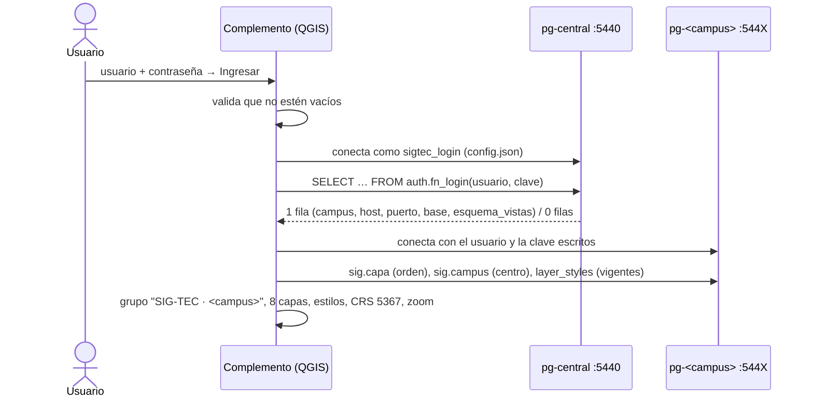

# SIG-TEC — Complemento PyQGIS y estilos compartidos

*Módulo: Samuel — Edición geográfica desde QGIS y complemento PyQGIS (20 %)*

## 1. Resumen

| Pieza | Dónde | Qué hace |
|---|---|---|
| Complemento **SIG-TEC** | `plugin/sigtec/` | Ventana de ingreso → autentica en el central → carga las 8 vistas `capas.*` del nodo del campus con su estilo |
| Estilos compartidos | `sql/estilos/`, `public.layer_styles` | Estilos QGIS guardados en la BD del central, versionados y replicados a los 5 campus |
| Estilos base (.qml / .sld) | `plugin/sigtec/estilos/` | Generados con PyQGIS (`plugin/dev/generar_estilos.py`); se publican al central y sirven de respaldo |
| Scripts | `scripts/configurar_estilos.sh`, `scripts/publicar_estilos.sh`, `plugin/*.ps1` | Distribución de estilos, publicación de versiones, instalación y empaquetado |
| Herramientas de desarrollo | `plugin/dev/` | Vistas **temporales**, generadores (estilos, icono) y pruebas sin interfaz |

Compatibilidad: **QGIS 3.34+ (Qt5) y QGIS 4.x (Qt6)**. Se probó con QGIS 4.2.3 (OSGeo4W). Solo usa la API de QGIS (`qgis.PyQt`, `QgsProviderRegistry…createConnection().executeSql()`), sin psycopg2.

## 2. Flujo de ingreso



1. **Validación local.** El botón *Ingresar* está deshabilitado mientras falte el usuario o la contraseña. Un usuario hecho solo de espacios cuenta como vacío. El núcleo vuelve a validar, así que un dato vacío nunca llega al servidor.
2. **Central.** El complemento se conecta con el rol `sigtec_login`. Ese rol solo puede ejecutar `auth.fn_login` y leer `sig.capa`, `sig.campus` y `layer_styles`. El host, el puerto y la clave salen de `plugin/sigtec/config.json`; por defecto son `localhost:5440`, `sigtec`, `sigtec_login` y `login2026`. Los valores que escribe el usuario se envían como literales escapados.
3. **Respuestas y mensajes.** Cada caso tiene su propio mensaje:

| Caso | Mensaje |
|---|---|
| Datos vacíos | «Escriba el usuario y la contraseña.» |
| 0 filas | «Usuario o contraseña incorrectos, o el usuario está inactivo.» (además se borra la contraseña) |
| Central inalcanzable o clave de `sigtec_login` mala | «No se puede conectar al servidor central (host:puerto)…» |
| Credenciales válidas pero el nodo del campus no responde | «El usuario es válido, pero no se puede conectar al nodo del campus …». En este caso no se quitan las capas que ya estaban cargadas. |

4. **Nodo del campus.** La conexión usa el `username` que devolvió `fn_login`, ya normalizado (sin espacios y en minúsculas), y la clave escrita. El rol de login en el nodo lo crea `11_usuarios_nodo.sql` o `scripts/crear_usuario.sh`.
5. **Sesión visible.** La barra de estado muestra `SIG-TEC: <usuario> (<rol>) · <campus>`. Además aparece un mensaje en la barra superior con el número de capas cargadas.
6. **Cerrar sesión.** El menú *Complementos › SIG-TEC* tiene la opción *Cerrar sesión SIG-TEC*, que quita el grupo y sus capas.

Cada intento de ingreso queda en `auth.bitacora_acceso` del central. Los mensajes técnicos van al registro de QGIS, en la pestaña **SIG-TEC**.

## 3. Carga de capas

- **Catálogo.** El complemento lee `SELECT capa_codigo, nombre, tipo_geom FROM sig.capa ORDER BY orden` en el nodo del campus.
- **Construcción de cada capa.** Cada una se arma con `QgsDataSourceUri` sobre `<esquema_vistas>.<capa_codigo>` (hoy `capas.*`) con estos parámetros:

  | Parámetro | Valor |
  |---|---|
  | Clave | `id` (ID global) |
  | Geometría | `geom` |
  | SRID | `5367` |
  | Tipo de geometría | explícito (`Point` / `LineString` / `Polygon`), porque las vistas no siempre lo informan |
  | `checkPrimaryKeyUnicity` | `0`, para no recorrer toda la vista |

- **Grupo.** Las capas van en el grupo **«SIG-TEC · \<nombre del campus\>»**, en la cima del árbol. El orden sale de `sig.capa.orden`: los puntos quedan arriba y los polígonos abajo.
- **Proyecto y mapa.** El CRS del proyecto y del lienzo queda en **EPSG:5367**. El zoom es un recuadro de ±250 m (`margen_zoom_m` en `config.json`) alrededor de `sig.campus.centro`.
- **Permisos según el rol.**
  - **Consulta:** todas las capas en solo lectura (`setReadOnly`); ni siquiera se puede iniciar la edición.
  - **Editor:** las capas se pueden editar y los elementos nuevos llevan por defecto `campus_id = <campus del usuario>`. Es solo comodidad: **quien impide editar otro campus es el servidor** (disparadores INSTEAD OF y permisos), no el complemento.
- **Capas que fallan.** Si una capa no es válida, el complemento avisa cuál en la barra de mensajes y sigue con las demás.
- **Reingreso.** Al ingresar otra vez se quita primero el grupo anterior con sus capas. El grupo se reconoce por la propiedad `sigtec/grupo`.
- **Estilo de cada capa.** Se aplica el estilo **vigente** de `public.layer_styles` del nodo del campus. Si no hay o falla, se usa `plugin/sigtec/estilos/<capa>.qml`. El origen queda en la propiedad `sigtec/estilo` de la capa (`bd:edificios v1`, `qml:edificios.qml` o `ninguno`).

## 4. Estilos compartidos

### 4.1 Tabla `public.layer_styles`

Tiene la estructura **exacta** que crea QGIS al guardar un estilo en la BD. Para verificarla, dejé que QGIS 4.2 la creara en una base vacía y comparé columna por columna; coincide con la de QGIS 3.x reciente, que incluye `type` y `r_raster_column`. Está en el central y en los 5 campus (`sql/estilos/01_layer_styles.sql`) y se crea en el init de cada nodo.

| Columna | Valor en SIG-TEC |
|---|---|
| `f_table_catalog` / `f_table_schema` / `f_table_name` / `f_geometry_column` | `sigtec` / `capas` / `<capa_codigo>` / `geom` |
| `stylename` | `<capa_codigo> v<N>` |
| `styleqml` / `stylesld` | QML completo / SLD |
| `useasdefault` | `true` solo en la versión vigente |
| `description` | `SIG-TEC · <Capa> · versión N · <descripción del cambio>` |
| `type` | `NULL` (QGIS busca `type = <tipo del URI> OR type IS NULL`, así que aplica siempre) |

### 4.2 Versiones (convención `stylename` + `useasdefault`)

Elegí lo más simple que cumple: no hay tablas extra y **cada versión es una fila** de `layer_styles`.

- `sig.fn_publicar_estilo(capa, qml, sld, descripción)`, solo en el central:
  - crea `<capa> v<N+1>` y la deja vigente;
  - si el QML es idéntico al vigente, responde `sin cambios` y no crea versión.
- `sig.fn_activar_estilo(capa, N)` vuelve a dejar vigente una versión anterior (rollback).
- El disparador `tg_estilo_vigente_unico` garantiza **un solo** `useasdefault` por capa.
- `sig.v_estilos` lista capa, versión, si es la vigente, fecha y descripción. Está en todos los nodos.
- Las versiones anteriores también se ven en QGIS: *Propiedades de la capa › Estilo › Cargar estilo › Desde la base de datos*.

### 4.3 Distribución (central → campus)

```
pg-central  public.layer_styles ──pub_estilos──► sub_cartago_estilos   (pg-cartago)
                                             ├─► sub_sanjose_estilos   (pg-sanjose)
                                             ├─► sub_sancarlos_estilos (pg-sancarlos)
                                             ├─► sub_alajuela_estilos  (pg-alajuela)
                                             └─► sub_limon_estilos     (pg-limon)
```

- **Publicación y suscripciones.** La publicación `pub_estilos` (`FOR TABLE public.layer_styles`) se crea en el init del central. Las 5 suscripciones las crea `scripts/configurar_estilos.sh` **como postgres**; `replicador` solo va en `CONNECTION`. El script es idempotente.
- **Escritura solo en el central.** En los campus la tabla es de **solo lectura, incluso para postgres**: el disparador `tg_estilos_solo_central` rechaza escrituras locales. Un id local chocaría con los que llegan del central y detendría la suscripción. La replicación no dispara ese disparador.
- **Lectura.** `sigtec_lectura` (y por tanto los editores) y `replicador` pueden leer en todos los nodos, y `sigtec_login` en el central.
- **Independencia de la replicación de datos.** Esta distribución no depende de la de Gabo: funciona desde ya.

### 4.4 Cómo se ven las capas (`plugin/sigtec/estilos/*.qml`)

Los genera `plugin/dev/generar_estilos.py` con PyQGIS sobre las vistas reales, en el formato exacto de la versión de QGIS que los produce. Cada QML incluye:

- **Simbología** categorizada:

| Capa | Clasificada por | Notas |
|---|---|---|
| edificios | `uso` | 8 colores + «sin uso» |
| carreteras | `tipo` | grosor según jerarquía |
| aceras | `condicion` | mala = discontinua |
| parqueos | `tipo` | discapacidad en morado |
| zonas_verdes | `tipo_vegetacion` | gama de verdes |
| puntos_interes | `tipo` | forma y color por tipo |
| iluminacion | `estado` | estrella amarilla / X roja / triángulo naranja |
| accesibilidad | `tipo` | rampas en azul, ruta podotáctil punteada |

- **Etiquetas** por nombre, visibles al acercarse, en edificios, carreteras, parqueos y puntos de interés.
- **Formularios:**
  - **Value Map** con los valores permitidos de cada `CHECK` (tabla 4.2 de `01_arquitectura.md`), con etiquetas legibles («Académico», «Dañada»…), más la opción «Sin definir» en los campos que aceptan NULL. `campus_id` se muestra con el nombre del campus.
  - **Solo lectura:** `id`, `campus_id`, `area_m2`, `longitud_m`, `creado_en`, `actualizado_en` y `actualizado_por`.
  - **Restricciones** iguales a las de la BD: no nulo en los campos obligatorios, `espacios_disponibles ≤ capacidad`, `ancho_m > 0` y `potencia_w > 0`. Se avisa antes de guardar.
  - **Valores por defecto:** `pisos` = 1, `estado` = funcionando / buena, `cumple_ley_7600` = sí.
  - **Alias** legibles y expresión de visualización.

### 4.5 Cambiar un estilo

Hay dos formas de producir el QML nuevo:
- **Con el generador:** editar `generar_estilos.py` y volver a ejecutarlo.
- **A mano en QGIS:** ajustar el estilo y usar *Estilo › Guardar estilo › Archivo QML* sobre `plugin/sigtec/estilos/<capa>.qml`.

Después:

```bash
./scripts/publicar_estilos.sh -m "Edificios: nuevo color para laboratorios" edificios
# rollback:
docker exec pg-central psql -U postgres -d sigtec -c "SELECT sig.fn_activar_estilo('edificios', 1)"
```

El nuevo estilo se ve al volver a ingresar con el complemento, o con *Cargar estilo › Predeterminado de la BD*. No conviene guardar estilos desde QGIS directamente en un nodo de campus: el disparador lo rechaza.

## 5. Instalación

**Primera vez (o después de `docker compose down -v`):**
```bash
docker compose up -d                      # esperar 6 healthy
./scripts/configurar_estilos.sh           # suscripciones sub_<campus>_estilos
./scripts/publicar_estilos.sh -m "Versión inicial"
./plugin/dev/aplicar_vistas_temporales.sh # SOLO mientras no existan las vistas reales de sql/vistas/
```

**El complemento en QGIS (Windows):**
```powershell
powershell -ExecutionPolicy Bypass -File plugin\instalar_windows.ps1   # copia a %APPDATA%\QGIS\QGIS3|QGIS4\profiles\default\python\plugins\sigtec
powershell -ExecutionPolicy Bypass -File plugin\empaquetar_zip.ps1     # crea dist\sigtec-0.1.0.zip
```

- **Activarlo:** *Complementos › Administrar e instalar complementos › Instalados › SIG-TEC*. Otra opción es *Instalar a partir de ZIP* con el `.zip` generado.
- **Instalador:** detecta los perfiles de QGIS3 y QGIS4 que existan y conserva un `config.json` ya editado.
- **Servidor central en otra máquina:** cambiar `host` en `config.json` y `SIGTEC_HOST_CLIENTE` en `.env`. Este último es el host que `fn_login` le devuelve a QGIS para llegar al nodo.

## 6. Pruebas

**Sin interfaz** (64 pruebas): `python-qgis plugin/dev/pruebas_headless.py [--replicacion]`. Se corren desde *OSGeo4W Shell* o con `%LOCALAPPDATA%\Programs\OSGeo4W\bin\python-qgis.bat`. Usan Qt *offscreen*, así que prueban el núcleo, el diálogo y el complemento completo con un `iface` simulado:

- **Login:** correcto, mayúsculas y espacios, clave mala, usuario inexistente, intento de inyección, campos vacíos (y que no lleguen a la bitácora), central apagado y clave mala de `sigtec_login`.
- **Capas:**
  - 8 capas válidas, con SRID 5367, tipo de geometría correcto, clave `id` y orden de dibujo correcto;
  - estilo vigente aplicado desde la BD, respaldo `.qml` si falla y Value Map / solo lectura;
  - zoom al campus, reingreso con quitado del grupo anterior, rol consulta en solo lectura, capa inválida y nodo caído.
- **Diálogo:** botón deshabilitado, mensajes de error, contraseña borrada y aceptación con clave correcta.
- **Complemento:** `initGui`, barra de estado, mensaje, CRS y zoom del lienzo, cerrar sesión y `unload`. También la carga por `qgis.utils` como complemento instalado y la compatibilidad de `metadata.txt`.
- **`--replicacion`:** exige que cada capa tenga registros de los 5 campus. Se verificó con una replicación temporal de prueba, que ya se borró.

**Lista de verificación manual (con interfaz):**
- [ ] El botón y el menú *Complementos › SIG-TEC* aparecen con su icono.
- [ ] Al ingresar con `editor_sancarlos` / `Tec2026!` aparece el grupo «SIG-TEC · Campus Tecnológico Local San Carlos» con las 8 capas, el zoom va al campus y la barra de estado indica usuario y campus.
- [ ] La simbología se ve como se espera: colores por uso, estado y tipo, y las etiquetas aparecen al acercarse.
- [ ] Con *Identificar* o la tabla de atributos, los campos muestran alias y valores legibles.
- [ ] Al iniciar la edición, el formulario de un elemento nuevo muestra listas desplegables y los campos de solo lectura deshabilitados. `campus_id` sale «San Carlos».
- [ ] Una clave incorrecta da el mensaje en rojo y la ventana sigue abierta. Con el central apagado (`docker stop pg-central`), el mensaje es el de conexión.
- [ ] Con `consulta_sancarlos`, el lápiz de edición queda deshabilitado en las 8 capas.
- [ ] Al volver a ingresar con otro usuario no quedan capas duplicadas.
- [ ] *Cuando Gabo entregue las vistas:* se pueden crear, mover y borrar elementos del campus propio, y editar uno de otro campus da error del servidor.
- [ ] *Cuando haya replicación:* se ven datos de los 5 campus (zoom a cada uno con *Zoom a la capa*).
- [ ] Al publicar una v2 de un estilo y volver a ingresar se ve el cambio. *Cargar estilo › Desde BD* lista v1 y v2.

## 7. Capturas sugeridas para el documento final

1. La ventana de ingreso (vacía, y con el error de clave incorrecta).
2. QGIS justo después de ingresar: el árbol de capas con el grupo «SIG-TEC · …», el mapa con la simbología y la barra de estado con el usuario.
3. El formulario de un edificio en edición, con el Value Map de *Uso* desplegado y `area_m2` y `campus_id` en solo lectura.
4. La misma vista con datos de los 5 campus, una vez activa la replicación.
5. El error del servidor al intentar editar un elemento de otro campus.
6. `SELECT * FROM sig.v_estilos` en el central y en un campus (mismas filas), y el diálogo *Cargar estilo › Desde BD* con varias versiones.
7. `auth.bitacora_acceso` con intentos exitosos y fallidos.

## 8. Limitaciones conocidas

- **Contraseña en el proyecto.** La clave del usuario va en el URI de las capas. Si el usuario **guarda el proyecto `.qgz`**, QGIS la escribe en el archivo. No es necesario guardar el proyecto, porque el complemento recarga todo al ingresar. Usar `authcfg` (gestor de autenticación de QGIS) evitaría esto, pero exige que cada usuario configure una contraseña maestra.
- **Clave de `sigtec_login`.** Va en `config.json`. Es de mínimo privilegio: solo puede ejecutar `fn_login` y leer catálogos y estilos.
- **Vistas temporales.** Las de `plugin/dev/` son de solo lectura. La edición real depende de las vistas con INSTEAD OF de `sql/vistas/`. El complemento no cambia cuando lleguen, porque usa los mismos nombres y columnas.
